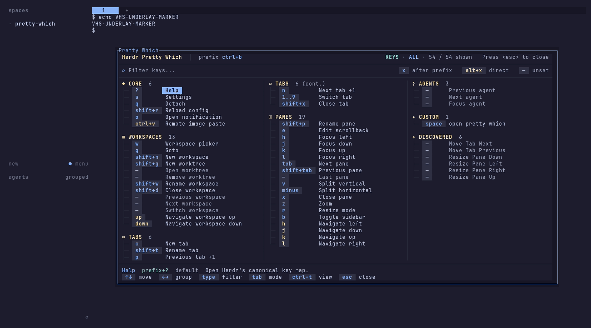
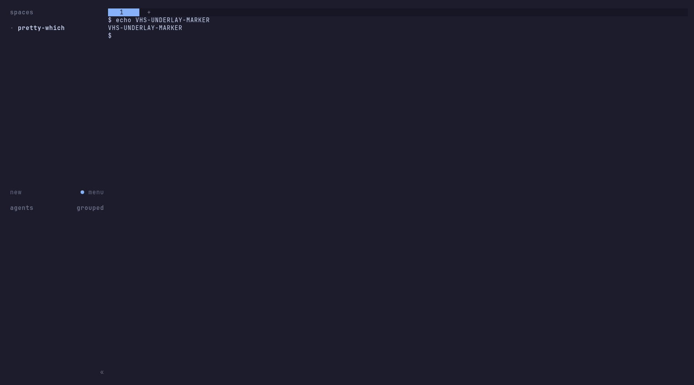

# Herdr Pretty Which

[](https://crates.io/crates/herdr-pretty-which)
[](https://docs.rs/herdr-pretty-which)
[](https://github.com/ramarivera/herdr-pretty-which/actions/workflows/ci.yml)
[](LICENSE)



A keybinding guide, command launcher, and shell for [Herdr](https://herdr.dev), built with Rust and Ratatui. The keybinding guide reads your Herdr config and defaults rather than inventing bindings. The launcher combines bindings with live plugin actions and custom commands, removing duplicate entries.

The recording below shows the earlier guide. In this beta, press `Ctrl+F` before typing a search.



## Install the beta

Version `0.3.0-beta.2` combines the guide, launcher, and shell for testing. Herdr Palette remains supported as a separate plugin while this beta is evaluated.

Requires Herdr 0.7.4 or newer for popup plugin panes. The beta terminal flows were tested against Herdr `0.9.4-preview.2026-10-14-fbd2ae23927f`. Install the crate and link its manifest:

```nu
cargo install herdr-pretty-which --version 0.3.0-beta.2 --locked
herdr-pretty-which --install-plugin
herdr plugin action invoke ramarivera.pretty-which.open
```

For a GitHub-managed checkout, Herdr builds the current main branch during install. That branch currently contains the beta:

```nu
herdr plugin install ramarivera/herdr-pretty-which
```

For local development only, use `cargo install --path . --locked` followed by `herdr-pretty-which --install-plugin`. The install command writes a versioned manifest to your user data directory and links its absolute path in Herdr. Run it again after upgrading the binary.

## Modes and keybindings

The plugin has three actions and matching CLI modes:

| Action | CLI | Purpose |
| --- | --- | --- |
| `ramarivera.pretty-which.open` | `herdr-pretty-which --mode keys` | Keybinding guide, the default |
| `ramarivera.pretty-which.launcher` | `herdr-pretty-which --mode launcher` | Search and run supported actions |
| `ramarivera.pretty-which.shell` | `herdr-pretty-which --mode shell` | Run a command in your login shell |

`--shell` is an alias for `--mode shell`. The shell captures output without interactive input; it isn't a full interactive terminal.

Bind any action in Herdr's config. For example:

```toml
[[keys.command]]
description = "open pretty which"
key = "prefix+space"
type = "plugin_action"
command = "ramarivera.pretty-which.open"
```

The existing `open` action and `overlay` pane still open the keybinding guide. The guide and launcher use 90% of terminal width and 80% of its height. The standalone shell opens in a compact 12-row popup. Input and output wrap, with recent output kept in view. Herdr currently fixes popup size at creation, so it cannot grow with output; shell mode entered with `Ctrl+S` retains the launcher size.

## Controls

In the guide, type the group key and then the actual binding key in sequence, such as `w` then `w`. Press `Ctrl+F` for fuzzy search. In the launcher, select a supported action and press `Enter` to run it. Rename actions ask for a new name; close actions require typing `yes`. Plugin actions preserve the caller's workspace, tab, pane, and working directory. Entries marked `chord only` need their original Herdr shortcut because the public host API doesn't expose the equivalent client action or popup lifecycle. This includes help, settings, sidebar toggling, and custom pane/popup commands. Press `Ctrl+R` to refresh live sources; source failures appear in the footer.

Press `Ctrl+S` to switch between launcher and shell. Use the arrow keys to navigate, `Ctrl+T` to change view, and `Esc` to close. The guide offers KEYS, TREE and LIST views; the launcher offers TREE and LIST. The selected view is saved between runs. Override it at startup with `--view keys`, `--view tree`, or `--view list`; launcher mode accepts `tree` and `list`.

## Trying the beta alongside Herdr Palette

Keep Herdr Palette installed while testing. Install and link this beta as above, then change your test bindings from `ramarivera.palette.open` to `ramarivera.pretty-which.launcher` and from `ramarivera.palette.shell` to `ramarivera.pretty-which.shell`. The old action IDs don't automatically redirect. To return to Palette, restore those two original action IDs. Neither repository is deprecated or archived.

## Theming

With the `terminal` theme or `[theme.custom] text = "reset"`, body text and backgrounds follow your terminal defaults. Headings and shortcuts use blue and magenta from your terminal's current ANSI palette, so their actual colors follow your terminal theme rather than a fixed Catppuccin preset. Badge backgrounds stay transparent. Selection uses the theme's colored accent, with readable text, rather than reversing the default foreground and background. Explicit `selection_bg` and `active_row_bg` overrides are honored; if an override is neutral, a configured colored accent takes priority. Fully neutral custom themes remain neutral. Explicit color themes keep their RGB colors, with unreadable foregrounds adjusted against each rendered background.

## Testing

```nu
cargo test
cargo test --test render_snapshots
cargo test --test cli_e2e
```

Optional live Herdr smoke test, only when you explicitly want the socket/plugin loop:

```nu
$env.HERDR_LIVE_E2E = "1"
cargo test --test live_herdr_e2e -- --ignored
```

The live test links the local plugin and verifies Herdr can see/invoke it. It does not stop your server or delete sessions.

End-to-end popup test with [VHS](https://github.com/charmbracelet/vhs). It starts a throwaway Herdr server with isolated XDG configuration and state directories, opens the popup through the real keybinding, fails if the expected screens don't appear, and captures each mode:

```nu
$env.PRETTY_WHICH_VHS_ROOT = "/path/to/scratch/dir"
vhs tapes/pretty-which.tape
```

## License

MIT. Launcher and shell functionality builds on [Herdr Palette](https://github.com/ramarivera/herdr-palette), also MIT licensed.
